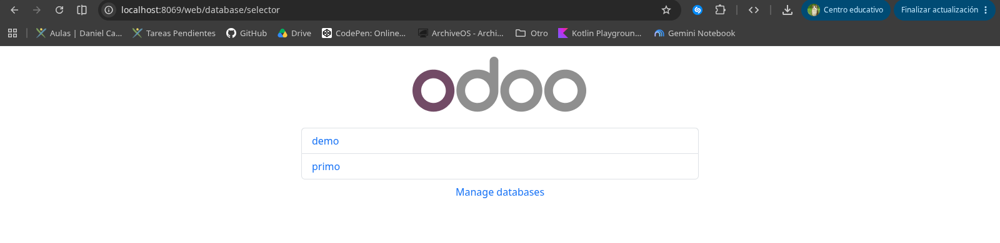
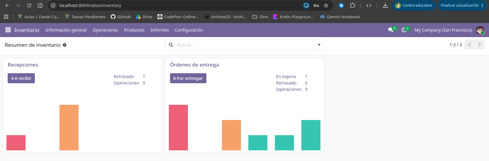
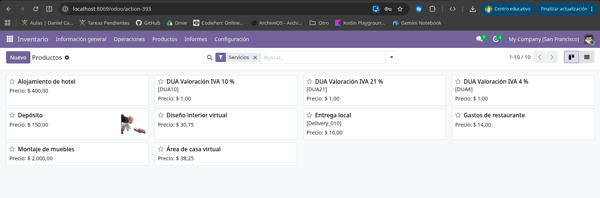
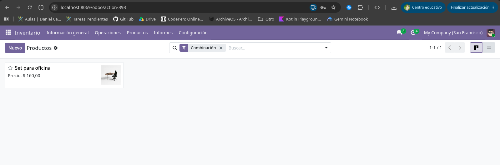
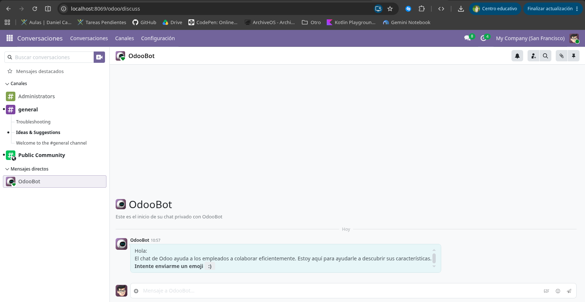

# SXE · Tarea 09 — Implantación de Odoo 19 con Docker Compose

Manual de implantación de Odoo 19 Community con PostgreSQL y pgAdmin, y
recorrido documentado por sus aplicaciones principales (Contactos, Ventas y
Facturación).

---

# Parte A · Manual de implantación

## A.1. Requisitos

- Docker Engine y Docker Compose v2.
- Conexión a internet la primera vez (para descargar las imágenes).
- Un navegador web moderno.

Probado con Docker 29.9.2 y Docker Compose v2.37.1.

## A.2. Estructura del proyecto

```
sxe_tarea09/
├── README.md            # Este manual
├── .gitignore           # Excluye el .env y copias locales con secretos
├── docker-compose.yml   # Pila: PostgreSQL + Odoo 19 + pgAdmin
├── .env                 # Valores reales de esta instalación (NO se sube)
├── .env.example         # Plantilla sin contraseñas para quien clone el repo
├── config/
│   └── odoo.conf        # Configuración de Odoo (master password placeholder)
├── addons/              # Módulos propios (vacía por ahora, para la UD4)
└── screenshots/         # Capturas de los ejercicios
```

## A.3. Puesta en marcha

```bash
# 1. Entrar en la carpeta del proyecto
cd sxe_tarea09

# 2. Copiar la plantilla y rellenar los valores
cp .env.example .env

# 3. Arrancar la pila en segundo plano
docker compose up -d

# 4. Comprobar que los servicios están sanos
docker compose ps        # db debe aparecer como (healthy)
docker compose logs -f odoo
```

### Accesos

| Servicio | URL | Usuario | Contraseña |
|---|---|---|---|
| Odoo 19 | http://localhost:8069 | el correo del administrador elegido al crear la BD | la elegida al crear la BD |
| pgAdmin | http://localhost:5050 | `${PGADMIN_EMAIL}` del `.env` | `${PGADMIN_PASSWORD}` del `.env` |
| PostgreSQL | localhost:5432 (desde Docker: `db:5432`) | `${POSTGRES_USER}` | `${POSTGRES_PASSWORD}` |

> Las contraseñas reales de esta instalación están en el fichero `.env`, que
> **no se sube al repositorio**. En el repositorio solo está `.env.example`.

### Parada y limpieza

```bash
docker compose down          # para los contenedores, conserva los volúmenes
docker compose down -v       # para los contenedores y borra los datos
```

### Trucos y avisos

- Si cambias `config/odoo.conf`, basta con `docker compose restart odoo`.
- Si cambias `.env` o `docker-compose.yml`, usa `docker compose up -d` para
  que se recreen los contenedores.
- Ante cualquier error, lo primero es el log:
  `docker compose logs --tail=100 odoo`.
- Al arrancar, Odoo puede mostrar el aviso
  `option addons_path, invalid addons directory '/mnt/extra-addons', skipped`.
  Es normal mientras la carpeta `addons/` esté vacía; desaparece cuando metas
  módulos propios.

## A.4. Nota sobre la master password

El fichero `config/odoo.conf` del repositorio lleva un **placeholder** en
`admin_passwd`. Antes de arrancar en serio, escribe ahí la master password
real (guárdala fuera del repositorio). Quien la conozca puede borrar o
descargar cualquier base de datos desde `/web/database/manager`.

---

# Parte B · Apartados obligatorios

> **Capturas necesarias** (guárdalas en `screenshots/` con estos nombres):
>
> | Fichero | Qué debe mostrar |
> |---|---|
> | `01-gestor-bd.png` | Gestor de bases de datos con `demo` y `primo` |
> | `02-producto-bien-rastreable.png` | Ficha de un producto **Bienes con Rastrear inventario** |
> | `03-producto-bien-sin-rastrear.png` | Ficha de un producto **Bienes sin Rastrear inventario** |
> | `04-producto-servicio.png` | Ficha de un producto **Servicio** |
> | `05-producto-combinacion.png` | Ficha de un producto **Combinación** |
> | `06-ej2-paso1-contactos.png` | Contacto de empresa y contacto de persona |
> | `07-ej2-paso2-nuevo-cliente.png` | Cliente nuevo con CIF, dirección y etiqueta |
> | `08-ej2-paso3-productos.png` | Productos **Hora de soporte** y **Libro técnico** |
> | `09-ej2-paso4-presupuesto.png` | Presupuesto enviado y confirmado (pedido de venta) |
> | `10-ej2-paso5-factura.png` | Factura con el IVA de cada línea y etiqueta **Pagado** |
> | `11-ej2-paso6-factura-proveedor.png` | Factura de proveedor de demostración |
> | `12-ej2-paso7-chatter.png` | Chatter con la actividad (llamada) programada |
> | `13-ej3-facturas-favoritas.png` | Facturas publicadas agrupadas por cliente + favorito |
> | `14-ej4-debug-ajustes.png` | Activación del modo desarrollador desde Ajustes |
> | `15-ej4-debug-url.png` | Activación del modo desarrollador con `?debug=1` |
> | `16-ej4-nombres-tecnicos.png` | Nombres técnicos de campos con el modo desarrollador |

## 1. Bases de datos

Se han creado dos bases de datos desde el gestor de Odoo
(http://localhost:8069 o `/web/database/manager`):

| Base de datos | Datos de demostración | Uso |
|---|---|---|
| `demo` | Sí | Explorar: clientes, productos, pedidos y facturas de ejemplo |
| `primo` | No | Base de datos vacía para la actividad 2, configurada desde cero |

- **Idioma:** Español (`es_ES`)
- **País:** España (el país se asigna a la compañía; la localización fiscal se
  instala con la app de Facturación)

En `demo` ya están instaladas las aplicaciones **Contactos**, **Ventas**,
**Facturación** e **Inventario**, junto con la localización española
(`l10n_es`), que crea los impuestos (IVA 21 %, 10 %, 4 %, 0 %, exento, recargo
de equivalencia y retenciones de IRPF, en versión de ventas y de compras).
`primo` queda vacía, solo con el módulo `base`, para la actividad 2.



> Captura necesaria: el gestor de bases de datos mostrando `demo` y `primo`.

## 2. Ejercicio 1 · Tipos de producto

En `demo`, ir a **Ventas → Productos** y localizar un producto de cada tipo.
Repasar también precio de venta, coste, categoría, unidad de medida e impuestos
de ventas y de compras.

| Tipo de producto | Qué es | Ejemplo | Inventario |
|---|---|---|---|
| **Bienes con Rastrear inventario** | Producto físico del que se controlan existencias (antes, almacenable) | Una silla de oficina | Entradas, salidas y stock por almacén |
| **Bienes sin Rastrear inventario** | Producto físico del que no se lleva stock (antes, consumible) | Folios, tornillería | Se entrega, pero no se cuenta |
| **Servicio** | Algo que se presta, no se entrega | Horas de instalación, mantenimiento | Nunca |
| **Combinación** | Conjunto de productos que se vende junto | Menú, pack de bienvenida | El de cada componente |

> En Odoo 17 y anteriores había tres tipos (almacenable, consumible y servicio).
> Desde Odoo 18 los tipos son **Bienes**, **Servicio** y **Combinación**; lo que
> distingue a los bienes es la casilla **Rastrear inventario**.








> Capturas necesarias: la ficha de un producto de cada tipo, con sus impuestos
> de ventas y compras visibles.

## 3. Ejercicio 2 · Recorrido: del cliente a la factura pagada

Recorrido completo con los datos de demostración. Guardar una captura de cada paso.

### Paso 1 · Contactos

Abrir un contacto de **empresa** y uno de **persona**. Fíjate en la diferencia
entre Compañía e Individuo y en cómo las personas quedan vinculadas a su empresa.



### Paso 2 · Cliente nuevo

Crear un cliente nuevo con su CIF y dirección, y asignarle una etiqueta.


### Paso 3 · Productos nuevos

Crear un servicio **Hora de soporte** a 40 € con Impuesto de ventas del 21 % y un
bien **Libro técnico** a 25 € con el 4 %. Marcar **Ventas** en los dos.


### Paso 4 · Presupuesto

En **Ventas**, crear un presupuesto para ese cliente con esos dos productos,
enviarlo (sin correo real) y confirmarlo. Pasa a ser **pedido de venta**.


### Paso 5 · Factura

Desde el pedido, crear la factura y comprobar que cada línea lleva su IVA y que
el total cuadra. Confirmarla, imprimirla en PDF y registrar el pago. Comprobar la
etiqueta **Pagado**.


### Paso 6 · Factura de proveedor

Localizar una factura de proveedor de los datos de demostración y comparar sus
campos con una de cliente.


### Paso 7 · Chatter

En la parte derecha o inferior de cualquier registro está el historial de
cambios, mensajes y actividades. Programar una actividad (una llamada) para el
cliente.


## 4. Ejercicio 3 · Búsqueda guardada

En **Facturación → Clientes → Facturas**, mostrar solo las facturas
**publicadas**, agrupadas por **cliente**, en vista **lista**, y guardarlo como
**favorito**.


> Captura necesaria: la lista de facturas publicadas agrupadas por cliente y el
> favorito guardado.

## 5. Ejercicio 4 · Modo desarrollador

El modo desarrollador muestra información técnica que un usuario normal no ve.
Hay dos vías de activación:

1. **Desde Ajustes:** al final de la página, en *Herramientas de desarrollador*,
   pulsar **Activar el modo desarrollador** (esta sección solo aparece si hay
   al menos una aplicación instalada).
2. **Desde la dirección:** añadir `?debug=1` a la URL, por ejemplo
   `http://localhost:8069/odoo?debug=1`. Con `?debug=0` se desactiva.

Se sabe que está activo porque aparece el icono del escarabajo en la barra
superior.


Con el modo desarrollador activo, al pasar el ratón sobre un campo se ve su
**nombre técnico** y el **modelo** al que pertenece.

| Campo del formulario | Nombre técnico | Modelo |
|---|---|---|
| CIF del contacto | `vat` | `res.partner` |
| Nombre del contacto | `name` | `res.partner` |
| Número de factura | `name` | `account.move` |
| Fecha de la factura | `invoice_date` | `account.move` |
| Importe total de la factura | `amount_total` | `account.move` |


> Capturas necesarias: las dos vías de activación y la tabla con los nombres
> técnicos (la tabla anterior es un ejemplo; rellénala con los campos que
> hayas inspeccionado).

## 6. Incidencias

Tabla con fecha, síntoma, causa y solución de cada problema encontrado.

| Fecha | Síntoma | Causa | Solución |
|---|---|---|---|
| | | | |

> Si no ha habido ninguna incidencia, escribir: “No se han producido
> incidencias”.

## 7. Declaración de uso de IA

| Herramienta | Para qué la usé | Qué cambié o revisé de su salida |
|---|---|---|
| OpenCode (asistente IA, modelo LongCat 2.5 Free) | Preparar los ficheros de despliegue (`docker-compose.yml`, `.env.example`, `config/odoo.conf`), redactar este README y resolver dudas sobre la tarea. | Revisé los valores generados (contraseñas y nombres de bases de datos) y completé el README con mis capturas y los datos reales de mi recorrido. |

> Ajusta esta declaración a lo que realmente hayas hecho: herramienta usada,
> para qué y qué modificaste de su salida.
