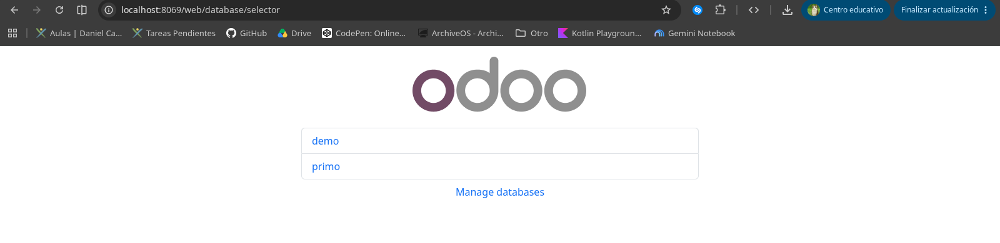
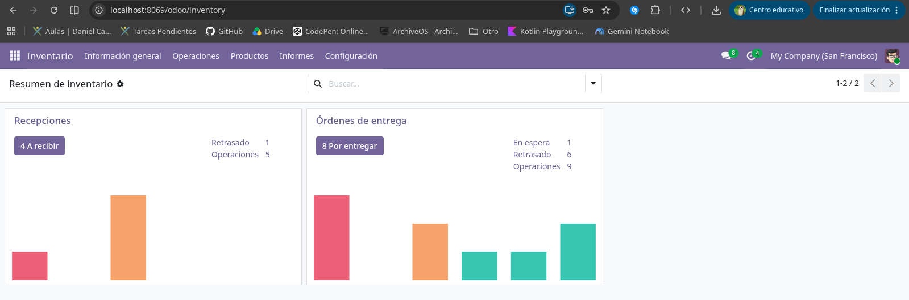
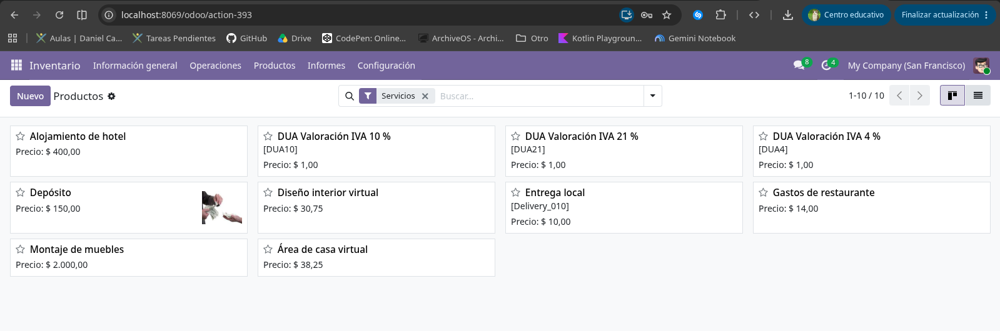
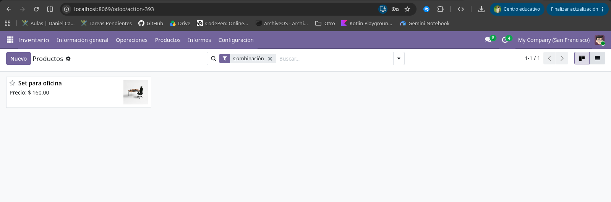
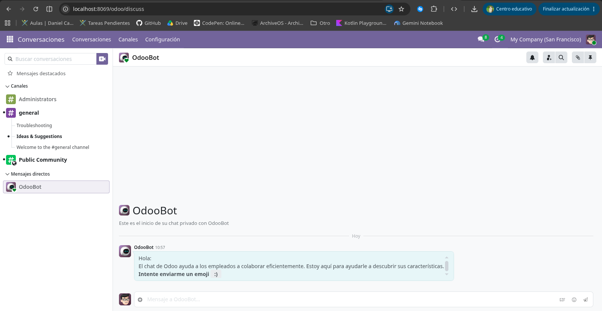

# SXE · Tarea 09 — Implantación de Odoo 19 con Docker Compose

Manual de implantación de Odoo 19 Community con PostgreSQL y pgAdmin, con las
evidencias disponibles de la instalación y de los ejercicios.

---

# Parte A · Manual de implantación

## A.1. Requisitos

- Docker Engine y Docker Compose v2.
- Conexión a internet la primera vez (para descargar las imágenes).
- Un navegador web moderno.

Probado con Docker 29.9.2 y Docker Compose v2.37.1.

## A.2. Estructura del proyecto

```
sxe_tarea09/
├── README.md            # Este manual
├── .gitignore           # Excluye el .env y copias locales con secretos
├── docker-compose.yml   # Pila: PostgreSQL + Odoo 19 + pgAdmin
├── .env.example         # Valores de ejemplo para quien clone el repo
├── config/
│   └── odoo.conf        # Configuración de Odoo (master password placeholder)
├── addons/
│   └── .gitkeep         # Conserva el directorio vacío en Git
└── screenshots/         # Capturas de los ejercicios
```

El fichero local `.env` se crea a partir de `.env.example` y no se versiona.

## A.3. Puesta en marcha

```bash
# 1. Entrar en la carpeta del proyecto
cd sxe_tarea09

# 2. Copiar la plantilla y rellenar los valores
cp .env.example .env

# 3. Arrancar la pila en segundo plano
docker compose up -d

# 4. Comprobar que los servicios están sanos
docker compose ps        # db debe aparecer como (healthy)
docker compose logs -f odoo
```

### Accesos

| Servicio | URL | Usuario | Contraseña |
|---|---|---|---|
| Odoo 19 | http://localhost:8069 | el correo del administrador elegido al crear la BD | la elegida al crear la BD |
| pgAdmin | http://localhost:5050 | `${PGADMIN_EMAIL}` del `.env` | `${PGADMIN_PASSWORD}` del `.env` |
| PostgreSQL | localhost:5432 (desde Docker: `db:5432`) | `${POSTGRES_USER}` | `${POSTGRES_PASSWORD}` |

> Las contraseñas reales de esta instalación están en el fichero `.env`, que
> **no se sube al repositorio**. En el repositorio solo está `.env.example`.

### Parada y limpieza

```bash
docker compose down          # para los contenedores, conserva los volúmenes
docker compose down -v       # para los contenedores y borra los datos
```

### Trucos y avisos

- Si cambias `config/odoo.conf`, basta con `docker compose restart odoo`.
- Si cambias `.env` o `docker-compose.yml`, usa `docker compose up -d` para
  que se recreen los contenedores.
- Ante cualquier error, lo primero es el log:
  `docker compose logs --tail=100 odoo`.

## A.4. Nota sobre la master password

El fichero `config/odoo.conf` del repositorio lleva un **placeholder** en
`admin_passwd`. Antes de arrancar en serio, escribe ahí la master password
real (guárdala fuera del repositorio). Quien la conozca puede borrar o
descargar cualquier base de datos desde `/web/database/manager`.

---

# Parte B · Evidencias de los ejercicios

## 1. Bases de datos

La captura disponible del gestor de Odoo muestra las bases de datos `demo` y
`primo`:

| Base de datos | Datos de demostración | Uso |
|---|---|---|
| `demo` | Sí | Explorar: clientes, productos, pedidos y facturas de ejemplo |
| `primo` | No | Base de datos vacía para la actividad 2, configurada desde cero |

- **Idioma:** Español (`es_ES`)
- **País:** España (el país se asigna a la compañía; la localización fiscal se
  instala con la app de Facturación)

En `demo` ya están instaladas las aplicaciones **Contactos**, **Ventas**,
**Facturación** e **Inventario**, junto con la localización española
(`l10n_es`), que crea los impuestos (IVA 21 %, 10 %, 4 %, 0 %, exento, recargo
de equivalencia y retenciones de IRPF, en versión de ventas y de compras).
`primo` queda vacía, solo con el módulo `base`, para la actividad 2.



## 2. Ejercicio 1 · Tipos de producto

La captura `02-producto-bien-rastreable.png` muestra el resumen de Inventario,
y es idéntica a `03-producto-bien-sin-rastrear.png`; no acredita dos productos
distintos. Las capturas restantes muestran una lista filtrada por servicios y
un producto de tipo combinación, no fichas de cada tipo con sus impuestos.

| Tipo de producto | Descripción | Seguimiento |
|---|---|---|
| **Bienes con Rastrear inventario** | Producto físico | Se controlan existencias |
| **Bienes sin Rastrear inventario** | Producto físico | No se controlan existencias |
| **Servicio** | Servicio prestado, no entregado como producto físico | No aplica |
| **Combinación** | Conjunto de productos que se vende junto | Depende de sus componentes |

> En Odoo 17 y anteriores había tres tipos (almacenable, consumible y servicio).
> Desde Odoo 18 los tipos son **Bienes**, **Servicio** y **Combinación**; lo que
> distingue a los bienes es la casilla **Rastrear inventario**.

* Bienes con Rastrear inventario: 
* Bienes sin Rastrear inventario: 
* Servicio: 
* Combinación: 

## 3. Ejercicio 2 · Recorrido: del cliente a la factura pagada

Solo hay evidencia disponible para el paso de contactos. El resto de los pasos
no se puede dar por completado a partir de los ficheros del repositorio.

### Paso 1 · Contactos

La captura disponible muestra un contacto de persona asociado a una compañía.



### Paso 2 · Cliente nuevo


### Paso 3 · Productos nuevos


### Paso 4 · Presupuesto


### Paso 5 · Factura


### Paso 6 · Factura de proveedor


### Paso 7 · Chatter


## 4. Ejercicio 3 · Búsqueda guardada

No hay captura disponible de la búsqueda guardada.

## 5. Ejercicio 4 · Modo desarrollador

El modo desarrollador muestra información técnica que un usuario normal no ve.
Hay dos vías de activación:

1. **Desde Ajustes:** al final de la página, en *Herramientas de desarrollador*,
   pulsar **Activar el modo desarrollador** (esta sección solo aparece si hay
   al menos una aplicación instalada).
2. **Desde la dirección:** añadir `?debug=1` a la URL, por ejemplo
   `http://localhost:8069/odoo?debug=1`. Con `?debug=0` se desactiva.

Se sabe que está activo porque aparece el icono del escarabajo en la barra
superior.

Con el modo desarrollador activo, al pasar el ratón sobre un campo se ve su
**nombre técnico** y el **modelo** al que pertenece.

| Campo | Nombre técnico | Modelo |
|---|---|---|
| CIF del contacto | `vat` | `res.partner` |
| Nombre del contacto | `name` | `res.partner` |
| Número de factura | `name` | `account.move` |
| Fecha de la factura | `invoice_date` | `account.move` |
| Importe total de la factura | `amount_total` | `account.move` |

No hay capturas disponibles de la activación del modo desarrollador ni de la
inspección de los nombres técnicos.

## 6. Incidencias

No hay incidencias documentadas en los ficheros disponibles; esto no permite
confirmar si se produjo alguna durante el recorrido.

| Fecha | Síntoma | Causa | Solución |
|---|---|---|---|
| Sin datos | No hay incidencias registradas | No consta | No consta |

## 7. Declaración de uso de IA

| Herramienta | Para qué la usé | Qué cambié o revisé de su salida |
|---|---|---|
| GitHub Copilot | Corregir el README y añadir `.gitignore`, `.env.example` y el marcador de `addons/`. | Se revisaron las capturas disponibles; no se inventaron evidencias para los pasos sin capturas. |
